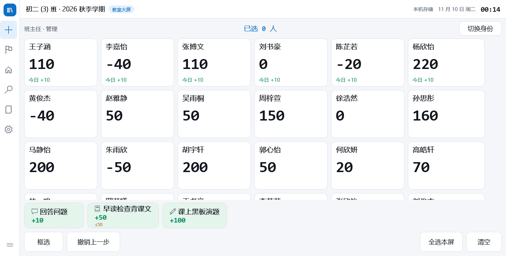
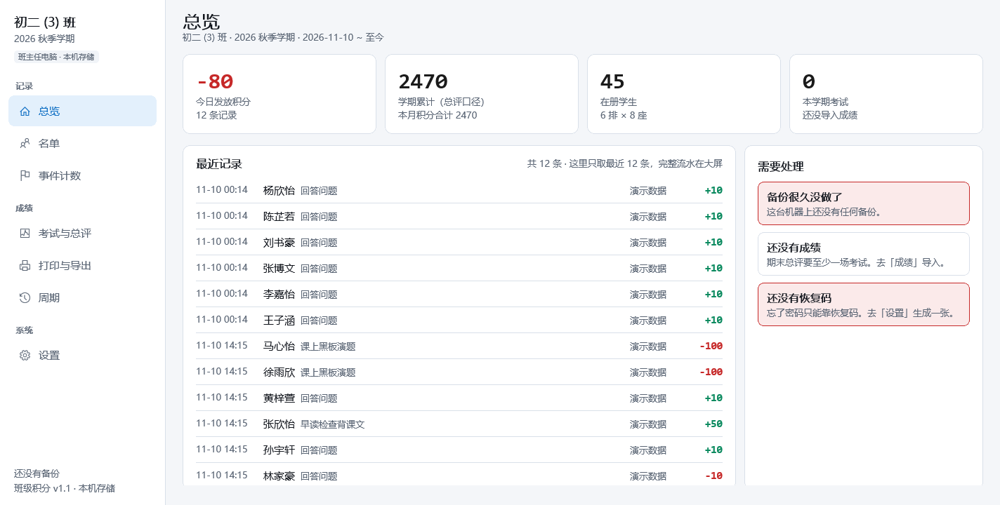
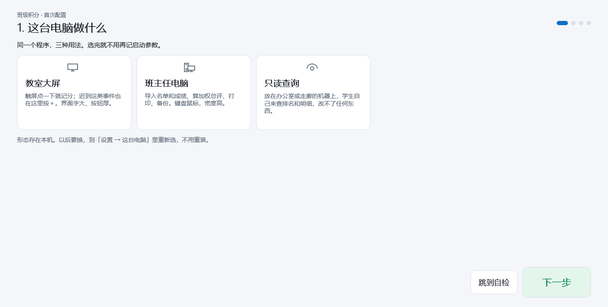

# 班级积分系统 · ClassPoints

面向中小学班主任的课堂积分工具。Windows 桌面应用（WinUI 3），**一个 exe 两种排版**，
第一次启动时在向导里选这台电脑长什么样 —— 之后不用再管，也没有任何命令行参数要记。

| 形态 | 放在哪 | 排版 |
| --- | --- | --- |
| **大屏端** | 教室一体机 / 触屏电视 | 56 宽图标轨 + 顶部常驻状态条，字大、按钮厚 |
| **电脑端** | 办公室电脑 | 236 宽文字侧栏，行高 40，键鼠密度 |

**两端的页面和权限完全一致**：记分台 · 事件计数 · 看板 · 查分 · 明细 · 名单 · 考试与总评 ·
周期 · 设置，九项都在两端。差别只有排版 —— 大屏用图标（教室三米外看不清小字），
电脑用文字（半米内要看全）。老师不必为了建个名单跑去办公室。


## 它解决什么

- **站着加分快到不用想。** 卡片网格一屏 48 人（8 列 × 6 行自适应），长按 400 ms 后拖拽框选，
  一次给十几个人加分；短滑只滚动、手掌压屏不误触。撤销条挂在底部 5 秒。
- **刷卡认人，不是刷分。** PN532 串口读卡，刷卡 300 ms 内切到该学生。
  卡是"我是谁"，不是"我有权限"——管理操作一律要 PIN，每条记录带操作人可追溯。
- **账不会算错。** 流水表只追加，总分永远 `SUM(delta)` 现算，不存在"总分字段和流水对不上"。
  撤销 = 追加一条冲销行 + 给原行打 `reversed_at`，谁在什么时候撤的都有据可查。
- **事件计数。** 迟到、作业未交这类"只数次数、不加分"的事，单独两张表按周期统计，
  可以手动加减、可以改成准确次数。事件类型自己定，不要了是"停用"而不是删除。
- **断网照用。** 本地写永远先成功，同步只是后台一条链路；断网时界面上只多一个"待推送"角标。
- **一个云端放几十个班。** 每张业务表都带 `class_id`，学号 `01` 每个班各有一个，互不相干。

## 两端长什么样

大屏端：左轨只有图标，顶部常驻状态条（班级 / 周期 / **当前身份** / 同步 / 时间），教室三米外看得清。



电脑端：248 宽的文字侧栏（原生 NavigationView）、40 行高、Excel 导入、加权排名、一键出表。



首次启动向导的第一步就问你"这台电脑做什么"，并且只有两个选项：



## 身份、权限与周期

**三种身份，两种权限。**

| 角色 | 能做什么 | 怎么认 |
| --- | --- | --- |
| 班主任 | 记分、计数、改名单、改分值、撤销任何记录、改设置 | 刷卡 / 6 位密码 |
| 班长 | 同上（管理权限与班主任一致） | 刷卡 / 6 位密码 |
| 班委 | 只能记分与计数 | 刷卡 / 6 位密码 |

**管理页有门槛。** 名单、考试与总评、周期、设置这四页要管理态：班主任/班长的卡或密码都放行，
班委的卡只能进记分台与事件计数，点这四页会停在密码面板前。这条和云端「班委令牌一律 403」
是同一条规则 —— 大屏是公开设备，"只把按钮藏起来"挡不住任何人。

**输谁的密码，就是谁。** 认人面板和每个页面顶上的身份胶囊都是同一个入口：
输入某个人的密码，系统按他的角色决定给不给管理权限 —— 不需要先"选角色"再输密码，
也不会出现"用班委密码进了管理模式"这种事。电脑端默认以班主任身份打开（办公室的机器本来就属于他），
要换人点侧栏的「切换」。

**没有凭据时不会把人锁在门外。** 刚装好、还没设过密码的机器，第一次进管理会直接以班主任身份放行并提示去补密码 ——
否则"进设置要身份、身份要在设置里设"就成了死锁。

**页面上的身份是常驻的。** 大屏在外壳顶栏、电脑在侧栏底部，切页不会消失 ——
教室里两个班委轮流记分，谁忘了换人就会把分记到别人头上。

**这套身份也跟到云端。** 配对时输的是谁的口令，签出来的令牌就是那个角色：
班主任密码或恢复码 → 班主任；某个成员自己的口令 → 他本人的角色。之后每一次写入服务端都会再判一次，
班委的令牌只能记分和撤销，改名单、改分值、建周期、重置周期、录成绩一律 403。
"界面上藏起来的按钮"和"接口不让调"必须是同一件事 —— 只藏按钮挡不住直接发请求。
成员被移除、或者从班长降成班委，他手上那台设备下一次续期就会跟着变（新增设备、撤人都不用等他手动退）。

**第四道门：机器也要过。** 口令是"给班里人的"，一旦发给班委就收不回来。
所以云端可以按机器再卡一次：班级开启设备审核后，新设备必须先被班主任在网页管理台上点通过，
才拿得到令牌（见「9.1 设备白名单」）。一台被撤销的机器，下一次续期就会断开。

**周期按序号，不按学期。** 每开一次新周期就是「第 1、2、3… 周期」，重置 = 把当前周期归档
（Excel 四表 + 数据库副本）再新建一个，记录一条不删。榜单看「本周期」，总评看「累计」——
两个数不一样，都对。考试也是学期口径：总评会算上全部场次（跨周期），所以「考试与总评」
列的是全部考试，不是只有本周期的几场。以前那套"学期编号 + 重置积分 / 重置学期两条路"已经拿掉了：
两个时间模型并存时，老师永远记不清自己按的是哪个。

---

## 一、编译与运行

### 环境

| 项目 | 版本 |
| --- | --- |
| .NET SDK | 10.0 |
| Windows App SDK | 2.6.5（`WindowsAppSDKSelfContained=true`，目标机不用另装运行时） |
| 目标框架 | `net10.0-windows10.0.26100.0`，最低 `10.0.17763.0` |
| 平台 | `x64` / `ARM64` |

不需要 Visual Studio，命令行就行：

```bash
dotnet build src/ClassPoints.App/ClassPoints.App.csproj -p:Platform=x64
```

打成可以整目录拷走的包：

```powershell
powershell -ExecutionPolicy Bypass -File scripts/publish.ps1 -Runtime win-x64
# 装了 PowerShell 7：pwsh scripts/publish.ps1 -Runtime win-x64
# 产物：dist/ClassPoints-win-x64/ ，整个目录拷到目标机，双击「启动.cmd」
```

只有一个启动脚本 `启动.cmd`，不带任何参数。用不上的语言资源在**编译期**就裁掉了
（`csproj` 的 `SatelliteResourceLanguages`），剩下九十来个 `Microsoft.ui.xaml.dll.mui`
目录是 WinUI 自带的，只占 4 MB 左右，别删。

> 改 `csproj` 时注意 `<EnableMsixTooling>` 必须是 `true`，哪怕不做 MSIX 打包（`WindowsPackageType=None`）。
> 设成 `false` 时 MSIX 公共 targets 整个不导入，`AddProjectPriToResolvedFileToPublish` 也就不存在，
> `dotnet publish` 出来的目录里没有 `ClassPoints.pri`，exe 一双击就 `XamlParseException`。
> 这个坑难查的原因是 `dotnet build` 的产物完全正常，只有 publish 的坏。`publish.ps1` 末段有硬性校验拦住它。

### 先看看长什么样

```bash
dotnet run --project tools/seed            # 生成 demo/demo.db：45 人、18 天流水、24 条事件
ClassPoints.exe --db demo/demo.db          # 直接用演示库，不碰自己的数据
```

演示库里的账号：班主任密码 `123456`，班委密码 `246810`，卡 UID `04A2B3C4D5E680`。

### 命令行参数与环境变量

唯一的参数是换库路径（演示、多班并行、验收用）：

| 参数 | 作用 |
| --- | --- |
| `--db=<路径>` | 用指定的库文件 |

排障用的环境变量（正常使用不需要设）：

| 变量 | 作用 |
| --- | --- |
| `CP_SNAP=<目录>` | 自截图模式：逐页渲染 PNG 后退出，见第八节 |
| `CP_MODE=board\|desk\|viewer` | 验收时强制形态，只影响这一次运行、不写库 |
| `CP_NORESIZE=1` | 不按上次尺寸还原窗口 |
| `CP_SYNC_PROXY=<url>` | 显式指定同步代理（默认不走系统代理，原因见第十一节） |
| `CP_SYNC_TRACE=1` | 把每次同步推送的路径与状态码打到 stderr |

---

## 二、部署同步中枢（可选）

**不部署也完全能用。** 纯本地模式下备份就是同步，换机器用「整包备份 → 导入」。
只有"教室大屏和办公室电脑要看到同一份数据"时才需要这一步。

同步中枢是 `worker/` 里的一个 Cloudflare Worker，数据存在 D1（SQLite）。免费额度足够一个班用好几年。

### 0. 前置

- 一个 Cloudflare 账号（免费版即可）
- Node.js 22+
- 一个托管在 Cloudflare 的域名（**可选，但国内强烈建议**，原因见第 6 步）

### 1. 装依赖

```bash
cd worker
npm ci
```

### 2. 建 D1 库

```bash
npx wrangler login          # 浏览器里点一下授权
npx wrangler d1 create classpoints
```

命令会打印一段 TOML，里面有一行 `database_id = "xxxxxxxx-xxxx-..."`。**复制它。**

### 3. 把 database_id 填进配置

打开 `worker/wrangler.toml`，替换这一行的占位符：

```toml
[[d1_databases]]
binding = "DB"
database_name = "classpoints"
database_id = "把上一步打印出来的 id 粘这里"
```

不填的话本地开发能跑，一上远端就报"找不到数据库"。

### 4. 建表

```bash
npx wrangler d1 migrations apply classpoints --remote
```

迁移文件在 `migrations/`。这条命令是幂等的，以后升级版本时重跑一次就够 ——
它只应用还没跑过的那些。**上过线之后只能新增 `0002_xxx.sql`，不要再改 `0001_init.sql`**
（SQLite 改表要走 12 步重建，不能在原文件上改）。

### 5. 设令牌签名密钥

```bash
npx wrangler secret put TOKEN_SECRET
# 提示时粘贴一段 32 字节以上的随机串
```

生成一段：

```bash
openssl rand -base64 32
# Windows 没有 openssl：
# powershell -Command "[Convert]::ToBase64String((1..32 | %{Get-Random -Max 256}))"
```

这个值只存在 Cloudflare 上，不要写进任何文件。**换掉它等于让所有已配对的设备立即失效**
（客户端会提示重新配对），所以存好。

长度必须在 32 字符以上：服务端启动时会自己检查，不够就直接返回
`500 weak_token_secret`，而不是带着一把弱钥匙开门 —— 早报错比晚出事好。

### 5.1 设建班口令（公网部署必做）

```bash
npx wrangler secret put BOOTSTRAP_SECRET
```

配了之后，`POST /api/v1/classes`（建班）必须带 `x-bootstrap-secret` 头，
客户端在「设置 → 云端同步」的建班区有一个「部署口令」输入框，填这里设的那个值。

不配也能用，但那就只剩「一个部署最多 20 个班」和「同一来源一小时最多建 10 个」
这两道软约束 —— 挡得住手滑，挡不住有心人。这个接口是整个服务端唯一不需要凭据就能写的口子。

### 6. 绑自有域名（强烈建议）

不绑的话你会拿到 `https://classpoints-api.<你的账号>.workers.dev`，
而这个域名在**部分国内网络下直接不通**（代理 `CONNECT` 返回 502），
教室里表现成"同步一直失败"，而你在开发机上因为挂着代理完全看不出来。

取消 `wrangler.toml` 里这段的注释，改成自己的子域：

```toml
[[routes]]
pattern = "classpoints.你的域名.com"
custom_domain = true
```

前提是这个域名的 DNS 已经托管在**同一个 Cloudflare 账号**下，否则 wrangler 找不到 zone，`deploy` 会失败。
`custom_domain = true` 会自动建 DNS 记录、自动签证书，不用手动去 DNS 面板加。

### 7. 发布

仓库里的 `wrangler.toml` 是**脱敏版**：`database_id` 是占位符、`[[routes]]` 注释掉了。
这是故意的 —— 库 id 和自有域名属于"部署者自己知道就行"的信息，写进公开仓库等于
把自己的用量账和攻击面一起交出去（`scripts/check-public-ready.sh` 也会直接判红）。

真正部署用本机那份 `worker/wrangler.deploy.toml`（已在 `.gitignore` 里）：

```bash
cd worker
npx wrangler deploy --config wrangler.deploy.toml
```

第一次创建这份文件：把 `wrangler.toml` 复制一份，填上自己的 `database_id`，再解注 `[[routes]]`。
**已经绑定的每一条自定义域都必须写上** —— `deploy` 会用配置里的 routes 覆盖线上绑定，
少写一条，那条域名当场解绑。

输出里会告诉你最终地址。

### 8. 验证

```bash
curl -i https://classpoints.你的域名.com/api/v1/ping
```

返回 **401** 就是活的（没带令牌，所以拒绝）。返回 502/超时说明域名或路由没生效；
返回 200 反而不正常。

### 9. 客户端配对

1. 电脑端「设置 → 同步 → 服务器地址」填上面那个地址，点「在这台电脑上建班」——
   如果这台机器上已经有班级数据，它会先问你要不要把现有数据推上去。
2. 记下 8 位班级码，在其它设备上点「配对到已有班级」，输班级码 + 班主任密码。

之后每台设备都是一个完整的本地副本，写的操作先落本地，后台再推。

### 9.1 设备白名单（可选，建议开）

口令是会传开的：班委要自己刷进来记分，班级码和密码必然在班里流通。
一旦传开，任何一台装了客户端的电脑都能读走全班名单、每一笔流水，甚至改成绩。
白名单就是给这件事加一道门 —— 它不替代口令，是口令之后加的一次"人点头"。

打开方式：浏览器访问 `https://你的域名/admin`，用**班级码 + 班主任密码**登录
（班长、班委的口令进不来，审批权只在班主任手里），把「新设备需批准」打开。之后：

1. 新设备配对会停在 `403 device_pending`，客户端界面上直接给出本机特征码；
2. 老师照着那串 4 位一段的十六进制（例如 `A1B2-C3D4-E5F6-0718-293A`）核对，
   或者在网页的「手动添加」里预先放行 —— 预置过的机器第一次就能进；
3. 点「通过」，设备再点一次配对就进来了。

几个行为值得先知道：

- **开开关不会踢人。** 切换的一刻，这台班上所有在用设备自动进白名单。
- **撤销立刻生效。** 点「撤销」后，那台机器下一次续期就失败；已经签发的令牌最长 12 小时内自然到期。
- **默认是关的。** 升级上来的老班什么都不用改，还是"口令对了就能进"。
- 特征码在客户端「设置 → 同步 → 本机特征码」，向导里的配对那一步也显示。
  重装系统会变，换 Windows 用户不会变。
- 管理台是 Worker 直接吐的一个页面，没有外链、没有第三方脚本，token 只放在标签页里。

### 关于免费额度

一个 45 人的班，一学年大约 3000 条流水，边写边同步：

| 资源 | 免费额度 | 实际用量 |
| --- | --- | --- |
| Workers 请求 | 10 万次/天 | 每天几百次（写操作合并成批，读按 30 秒节流） |
| D1 存储 | 5 GB | 一个班一年不到 20 MB |
| D1 读行 | 500 万行/天 | 增量拉取，每次只读变更 |

**数据在境外**（Cloudflare 边缘节点，通常是香港/新加坡）。学校或家长问起时这要能一句话说清：
存的是本班几十个学生的姓名与积分，随时可整包导出，也可以换到自建服务器。

### 升级服务端

```bash
cd worker
npm ci
npx wrangler d1 migrations apply classpoints --remote --config wrangler.deploy.toml  # 有新迁移才需要
npx wrangler deploy --config wrangler.deploy.toml
```

迁移只加列、带默认值，不锁表，随时可跑。但**先跑迁移再部署**：
新代码会读新列，顺序反过来那几分钟里所有请求都会 500。

**顺序不能颠倒**：服务端先上，客户端后升。云端要向后兼容，旧客户端才能继续用；
反过来做，旧 Worker 遇到新字段会 400，两台设备当场都不能用。

### 部署出问题先看这里

| 现象 | 原因 |
| --- | --- |
| `deploy` 报找不到 zone | 域名不在这个 Cloudflare 账号下，或者 NS 还没生效 |
| `d1 migrations apply` 报找不到库 | 配置里的 `database_id` 还是占位符 |
| 教室那台一直"同步失败"，开发机好的 | 用的 `*.workers.dev` 域名被墙，绑自有域名 |
| 建班/配对报 500，日志里是 `Pbkdf2 failed: iteration counts above 100000` | 迭代数撞了 Workers 的硬上限。见下面「10 万轮这条线」 |

### 10 万轮这条线（PBKDF2）

Cloudflare Workers 的 WebCrypto 对 PBKDF2 迭代数有**硬上限 100000**，超过直接抛
`NotSupportedError`，不是 CPU 预算，任何套餐都不放宽。而**本地 workerd 不检查这个上限** ——
所以它会以"本地全绿、线上第一下就 500"的方式出现。

由此派生两条规矩：

1. `PBKDF2_ITERATIONS`（服务端）和 `PasswordHasher.Iterations`（客户端）都不能高于 10 万。
   两边要一致，否则客户端存下的成员口令哈希服务端算不出来。
2. **已经存进库的、轮数超过 10 万的哈希，在 Workers 上永远验不过**（哈希不可降级）。
   服务端遇到这种行按"口令不对"处理，不会抛 500 —— 但如果某个成员是这种旧哈希，
   他自己的口令就刷不进来，得请班主任在客户端重新给他设一次口令（会生成新的 10 万轮哈希）。
   班主任密码和恢复码不受影响。
| 请求 500 而且只有走代理时出现 | 客户端默认 `UseProxy=false`；确实需要代理时设 `CP_SYNC_PROXY` |
| 所有设备同时要求重新配对 | `TOKEN_SECRET` 换过，或者重新 `deploy` 时丢了 secret |

---

## 三、部署客户端

三种形态都是同一个 exe，形态记在本机 `settings.app_mode`。要改：电脑端
「设置 → 这台电脑 → 切换为」，或点「重新运行首次配置…」—— **三种形态可以当场互换，不用重启、不用重装**。

### 预配置包：在家里配好，学校只用填分数

Cloudflare 部署、班级码这些一辈子只做一次的事，不该在教室那台机器上重做。

电脑端「设置 → 预配置 → 导出配置包」，得到 `.cpcfg` 文件（U 盘拷走即可）。包里带：
云端地址、班级码、班级名、周期起止、分值方案、加减分项定义、名单。
**不带**名单、成绩、流水，也**不带**班主任密码 —— 密码只存在账号里，不进包。

到学校那台机器，向导的第 2 步就是「预配置」：选文件、填口令、点「套用」，
后面的步骤会自动跳过包里已经有的项。没带 U 盘也行 —— 同一页底下有「用班级码直接连云端」，
填服务器地址、班级码和班主任密码就地把名单拉下来。

向导一共 7 步（形态 → 预配置 → 班级 → 名单 → 加减分项 → 密码 → 自检），
每一步都有「上一步」；从设置里重跑时右上角多一个「退出配置」，形态会原样退回，不会把机器留在半配置状态。

包默认用口令加密（DPAPI 换机后解不开，所以用口令派生密钥），口令 4–32 位，至少含数字或字母。
不加密也能导出，但文件里会有班级码，别随手发群里。导入是**幂等**的：同一个包导两次结果一样；
版本比本机新时会提示先升级程序，而不是硬塞进去。

---

## 四、目录结构

```
src/
  ClassPoints.Core/      领域层，无 UI 无 IO：排名、加权、缺考策略、姓名归一、密码哈希、图标目录
    Config/              预配置包（.cpcfg）的序列化、口令加密、校验与导入
  ClassPoints.Data/      数据层：SQLite 建表与迁移、仓储、入账、备份、同步客户端
    Sync/                Dpapi（DPAPI 加密）、SyncStore、SyncClient、SyncService
    Update/              更新清单校验、直连下载、安装流程（不带任何凭据）
    Net/                 出网地址规范化（只认 https，回环例外）
  ClassPoints.App/       WinUI 3 界面（两端共用九个功能页，只有排版不同）
    Board/               大屏排版：记分台、事件计数、看板、查分、明细、外壳
    Desk/                电脑排版：名单、考试与总评、周期、事件计数、设置、外壳
    Controls/            图标选择器、分数键盘（右侧抽屉）、身份胶囊、空状态、Toast
    Onboarding/          首次启动向导（形态 → 预配置 → 班级 → 名单 → 加减分项 → 密码 → 自检）
    Theme/               色板与样式（大屏 20/40/72，电脑 15/26/34，两套独立不缩放；浅/深两套取色）
    Services/            组合根、会话、导航表、外壳接口、PNG 自截图、同步心跳、PN532 读卡、更新中心、
                         FileDialogs（Win32 公共对话框）
worker/                  Cloudflare Worker + D1 同步中枢（TypeScript，不含更新通道）
  migrations/            D1 迁移（上过线之后只能加 0002_xxx.sql）
  src/admin.ts           网页管理台（单文件页面，零依赖零外链）
  src/routes/grants.ts   设备白名单：指纹闸门、待审队列、审批与撤销
  test/smoke.mjs         接口契约测试（92 项，含多班隔离与安全用例）
  test/grants.mjs        设备白名单回归（43 项，待审只读 → 批准升级 → 撤销 → 切回 open）
installer/               Inno Setup 安装脚本 + 简体中文语言包
tools/
  seed/                  演示数据生成器
  tests/                 Core + Data + 更新单测 + 端到端同步测试
  shot/                  窗口截图与局部放大（截图工具，非验收主通道）
docs/                    设计与验收文档、界面截图
scripts/publish.ps1      发布应用（可注入版本号与更新地址）
scripts/pack-installer.ps1      编译安装包
scripts/make-release-manifest.py 生成更新清单与 SHA256SUMS
scripts/upload-cnb-release.sh    把附件挂到 CNB 版本库
scripts/prune-cnb-releases.sh    清理 CNB 旧版本（保留 stable）
.cnb.yml                 CNB 云原生构建流水线
.github/workflows/       build.yml 日常构建 + release.yml 手动发正式版
```

---

## 五、数据、备份与事件计数

- **数据目录**（库、日志、同步凭据、更新包都在这里）按启动位置自动挑，优先级是：

  1. `--db` 指到别处时，跟着那个库所在目录走；
  2. 设置里「更改位置」记下的目录（写在程序目录下的 `classpoints.dir`）；
  3. 程序目录下的 `data\`（**装在非系统盘时就是它** —— 便携版、装到 D 盘的版本）；
  4. `%LOCALAPPDATA%\ClassPoints`（装在 Program Files 时的唯一可写位置）。

  同一个库只有一个文件：`classpoints.db`。装在非系统盘时会顺手把 `%LOCALAPPDATA%` 里的老库
  复制过来（原件不删），省系统盘空间；同一台机器上另一个 Windows 账号的班不会被顶掉。
  `设置 → 本机数据 → 更改位置…` 可以随时整目录搬走（一致性副本 + 自动重启）。
- 备份目录：默认跟着数据目录 —— 数据在非系统盘时是 `<数据目录>\backups`，
  数据还在 C 盘时用 `文档\班级积分备份\`（AppData 是隐藏目录，老师找不到就等于没有备份）。
  可在设置里改，每天首次启动自动备份一次，保留 30 天。换过默认目录的机器，旧目录里的备份
  仍会列在「最近的备份」里，并注明"另有 N 份在旧目录"。
- **本机重置**：`设置 → 本机数据 → 本机重置…`。要管理密码，先自动备份一份，再删库重启，
  回到首次配置向导（名单、积分、成绩、密码一起清掉）。设备转交或班级解散时用它，
  比"手动删文件"少一个找不到路径的环节。
- 换机器：`设置 → 备份与恢复 → 整包导出`，到新机器「从整包导入」。
- **换库之后会重启**：从备份恢复、导入整包都会替换数据库文件，完成后程序自动重新打开。
  只刷新界面不够 —— 内存里的会话、周期和形态还是旧库的。
- `entries` 表只追加。总分永远 `SUM(delta)` 现算，撤销是追加冲销行 + 给原行打 `reversed_at`。

### 表结构版本

`PRAGMA user_version` 现在是 **4**。v4 给 `rules` 补了 `owner_id`（NULL = 全班共用），
老库启动时自动 `ALTER TABLE`，不需要回填。服务端配套的是 `worker/migrations/0004_rule_owner.sql`，
**部署服务端时要记得 `wrangler d1 migrations apply --remote`** —— 少这一步，换台设备拉下来的
私有项会丢掉归属。

### 事件计数

单独两张表 —— `counters`（事件类型）和 `counter_ticks`（每按一次一条流水）。
**故意不混进 `entries`**：混进去以后，总分、总评、导出、看板的每一处都得记着排除它，迟早漏一处，
而漏一处的后果是所有学生的分数集体偏高 —— 这种错不会报错，只会在家长会上被发现。

- 次数 = `SUM(value)` 现算。`value` 允许是 `±N`，所以一条流水就能表示扣回两次。
- 「把次数改成 5」= 补一条差额流水，不改历史行。两台机器同步时改历史必打架，补差额永远收敛。
- 减到 0 就不再往下减；撤销（`UndoLast`）也是补一条反向记录，不删行。
- 事件类型可以自定义：名称 + 图标（12 个预设或不要图标），不要了是「停用」不是删除。
- 只按周期统计，不参与积分。两端都能加减，电脑端还能把某人的次数改成准确值。
- **事件计数目前只在本机，不参与云端同步**（worker 的实体白名单里没有这两张表）。
  大屏和电脑端是两台机器时，教室里记的事件不会出现在办公室那台 —— 两个事件页的副标题都把这件事写在明面上。

---

## 六、同步是怎么设计的

- 本地写永远先成功，同步只在后台跑。
- 每条写操作带 UUIDv7 幂等键，重传不会重复入账。
- 云端按 `rev` 做乐观并发（落后就 409），按 `changelog` 游标做增量拉取。
- 一个 D1 库放几十个班：所有唯一约束都是"班内唯一"，所有读写按令牌里的班级收口。
  越权的结果是**看不见**而不是报错：查不到、删不动、抢不到主键，
  接口返回 200/404 而不是 403 —— 403 等于告诉对方"这个 id 存在"。
- 密码只在服务端做 PBKDF2，明文不落库、不入日志；客户端只存 DPAPI 加密的 refresh token。
  迭代数顶在 10 万 —— 那是 Workers 运行时的硬上限，不是调参结果（见「10 万轮这条线」）。

### 安全上做了什么

按攻击面从外到内，这几条是实际实现的，不是愿望清单：

| 位置 | 做了什么 | 为什么 |
| --- | --- | --- |
| 传输 | 客户端只接受 `https://`，仅 `127.0.0.1`/`localhost` 放行 http | 同步的是全班名单和每笔加减分，明文走一遍等于摊在教室的 AP 上 |
| 建班 | 可选 `BOOTSTRAP_SECRET` + 单部署班级上限 + 频率限制 | 这是唯一不需要令牌就能写的接口，公网裸奔会被当免费数据库 |
| 配对 | 同来源 5 分钟错 6 次封 15 分钟；成功即清零 | 班级码 8 位、密码 6 位，在线无限猜是可以猜出来的 |
| 权限 | 令牌带真实角色（`owner` / `co_owner` / `officer`），写接口分两档：记分、撤销、读取 vs 其余全部管理动作 | 界面上藏起来的按钮挡不住直接调接口；角色必须由服务端认，不能由客户端自报 |
| 令牌 | HS256 密钥强制 ≥32 字符，服务端启动自检；refresh 一次一换、只存哈希 | 弱密钥等于没签名；refresh 落库后必须是"拿到表也换不出令牌" |
| 越权 | 所有读写按令牌里的 `class_id` 收口，越权一律"看不见"（200/404 而非 403） | 403 等于确认"这个 id 存在" |
| 出错 | 5xx 只回 `{error, requestId}`，原始 message 只进 `wrangler tail` | D1 的报错里带表名和 SQL 片段 |
| 请求体 | 单请求 >1 MB 直接 413 | 一个超大 POST 能把实例打爆 |
| 响应头 | HSTS / `nosniff` / `frame-ancestors 'none'` / CSP `default-src 'none'` | 这个域只吐 JSON，没有理由让它被嵌入或被嗅探 |
| CORS | 默认不返回 `access-control-allow-origin`，要开就配 `ALLOWED_ORIGINS` | 桌面客户端不走浏览器，没人用就别开门 |
| 凭据 | 仓库里没有 `.dev.vars`；CI 每次现场生成；CI 有一条密钥扫描 | 提交过一次的密钥就算泄露过，删提交也没用 |
| 更新 | 直连**公开**分发仓库的 Release 附件，安装包里零令牌；清单走白名单校验，下载后核对大小 + SHA-256 才执行 | 客户端不该持有能读私有库的长期凭据；清单是唯一的可信根，被改一个字节都要作废 |

限流计数落 D1 的 `auth_throttle` 表（`0002_security.sql`）。存的是 IP+UA 的加盐哈希，
不是 IP 本身 —— 表被看到也说不出"哪个地址试过密码"，只能看出"某个指纹试了几次"。

细节见 `worker/README.md`。

---

## 七、测试

```bash
# 1) Core + Data + 更新单测 225 项（纯内存，无需任何服务）
dotnet run --project tools/tests

# 2) Worker 接口契约 92 项 + 设备白名单 43 项（需要本地 wrangler dev 在 8787）
cd worker && npx wrangler dev --port 8787 --local
node test/smoke.mjs
node test/grants.mjs

# 3) 端到端同步 26 项（C# 客户端真连 Worker，两台设备互推互拉）
dotnet run --project tools/tests -- --sync http://127.0.0.1:8787

# 4) 可选：真连一个更新源，确认清单与安装包能匿名下载、哈希对得上
#    参数是版本库根地址；本地可用 python -m http.server 按
#    <根>/-/releases/download/<tag>/<文件> 摆好目录来模拟
dotnet run --project tools/tests -- --update-feed http://127.0.0.1:8892/demo/dist
```

合计 **386 项断言**（第 4 项另加 3 项，用于发布前核对真实产物）。

Worker 那 92 项里有 17 项专打多班隔离：两个班同时存在，学号 `01` 各算各的，
B 拉到 A 的学生/流水/周期/考试都是 0 条，B 删 A 的行返回 200 但不改一行，
B 抢 A 的主键被 `ON CONFLICT` 里的 `class_id` 守卫挡掉，B 撤 A 的批次、改 A 的权重都是 404。

那 225 项里有 29 项是事件计数（加减、改准确值、撤销、周期隔离、归档、图标迁移幂等），
有 17 项是 Excel 往返（ClosedXML 写 → NPOI 读，`.xlsx` 和 `.xls` 各来一遍），
有 29 项是版本与更新（三段式版本号、清单白名单校验、**直连地址拼接、不带凭据、404 视为无正式版**、
下载复用、哈希不符丢弃、断流不留残片）：
中文不乱码、学号 `01` 不被吃成 `1`、日期不变成 `45000`、公式按结果取、负数保号、尾部空行去掉。
更新那组会真起一个本地 HTTP 服务，把「下到一半断了」「服务器给了别的文件」这些只在真实 IO 里
出现的情况造出来 —— 比在教室里遇到一次再回头查划算得多。

想验真实部署的端点，把第 3 步的地址换成自己的 Worker 地址即可。

### CI

- **GitHub Actions**：
  - `build.yml`（每次 push）：`windows-latest` 编客户端 + 跑单测 + `publish.ps1` 出包并上传产物；
    `ubuntu-latest` 起 worker 跑 92 + 43 项契约测试；另有一条密钥扫描 job。
  - `release.yml`（**手动触发**，填版本号）：编译安装包、生成清单、上传 CNB 的 `v<版本>` 与 `stable` 两个标签。
    日常 push 永远不产生正式版。
- **CNB 云原生构建**（`.cnb.yml`）：一条管线跑 worker 冒烟，一条用 `dotnet/sdk:10.0` 编 `tools/tests`
  —— 顺手证明领域层是跨平台干净的。

两条流水线都有同一个坑：`wrangler dev` 是常驻进程，脚本跑完必须显式 `kill`，
否则容器会一直等到阶段超时（CNB 那边报 `error, 600135ms`，看着像测试失败，其实是没退出）。

### 界面验收：程序自渲染截图

远程会话 / 虚拟显示器上 WinUI 合成器不出画面，桌面截图拿不到内容，所以截图由程序自己渲染：

```bash
CP_MODE=board  CP_SNAP="…/shots/board"  ClassPoints.exe
CP_MODE=desk   CP_SNAP="…/shots/desk"   ClassPoints.exe
CP_SNAP="…/shots/wizard" ClassPoints.exe          # 不带 CP_MODE 就截向导本身
```

逐页产出 PNG（`board-1-wall … board-9-settings-bottom`、`desk-1-score … desk-9-settings`、
`wizard-1 … wizard-7`），长页面自动滚到底再补一张，电脑端最后还会当场切一次主题验证共享画刷。

`CP_MODE` 只覆盖这一次运行、不写库，所以同一台机器可以连跑两组。
长页面的中段两头都拍不到，加 `CP_SNAP_SCROLL=0.6`（0–1）会额外抓一张 `*-mid.png`。

---

## 八、界面约定

**不用 emoji。** 图标一律用系统自带的 Segoe MDL2 Assets 字形（私用区码点 `U+E000–U+F8FF`），
单色、不和配色打架、基线稳定，也不受系统 emoji 字体回退链影响（换了精简版系统也不会变成方框）。
图标目录在 `src/ClassPoints.Core/IconCatalog.cs`：12 个预设字形 +「不要图标」。
规则和事件都能选，存的是字形字符本身。老数据里的 emoji（`⭐`、`📖`）由
`Database.NormalizeIcons` 每次启动映射一遍，幂等。

**两端形状不同，不是同一套界面缩放；但功能一处不少。**

| | 大屏端 | 电脑端 |
| --- | --- | --- |
| 导航 | 原生 `NavigationView`，`LeftCompact`：平时 56 宽图标轨，左上汉堡展开成 248 宽带文字 | 原生 `NavigationView`，`Left`：常驻 248 宽，文字 + 系统图标 |
| 顶部 | 56 常驻状态条（班级 / 周期 / **身份胶囊** / 同步 / 日期 / 时钟） | 侧栏底部常驻身份胶囊，页内标题区 |
| 字号 | 20 / 40 / 72 | 15 / 26 / 34 |
| 行高 | 68 起，按钮 48 / 64 / 72 | 40，按钮 28 / 34 |
| 页面 | 九项全有；名单/考试/周期用电脑版页面（这些不是触屏高频操作） | 九项全有；记分台/看板/查分/明细用大屏版页面（鼠标同样能点） |

**按钮只有三档高度**：40 / 48 / 64（电脑端 28 / 34）。以前散着 40、44、48、52、56、60 六种，
同一行里两个按钮差 4 像素，比差 20 像素更显脏 —— 所以收成三档，`BtnSm` / `TouchSecondaryButton` / `BtnLg`。

**同一句话只写一遍。** 班级名、周期、身份、同步、日期时钟都归外壳，页面里不再重复 ——
新加常驻状态条时最容易犯的错就是页面里那句没删，屏幕上同一段话出现三次。

**说明文字只留一句必要的。** 每个区块一句副标题就够，够不上"必须知道"的一律删掉：
一屏全是解释性小字，等于没有重点。措辞按书面语写（"入口在设置里"而不是"到设置里点一下哈"）。

**表单：标签在上、控件在左。** 所有输入框都从 `DeskSettingsPage.Labelled / FieldRow`（向导里是
`Section`）出去，它们会显式把控件设成 `HorizontalAlignment.Left`。原因是 `StackPanel` 里子元素
默认 `Stretch`，而 `Stretch` 遇上显式 `Width` 会被摆到容器正中 —— 手写一个 `new TextBox { Width = 460 }`
塞进竖向 `StackPanel`，它就会飘到屏幕中间，和上面的标签错开。

**主按钮用系统的 `AccentButtonStyle`。** 颜色不写在样式里，而是覆盖 Palette.xaml 的
`AccentButtonBackground* / AccentButtonForeground*` 那组主题键 —— 悬停、按下、禁用、焦点矩形
全部由系统模板处理，和系统应用的按钮完全一致。**不要**直接给 Button 设 `Background`：
系统模板的 PointerOver 状态会把前景换成 `ButtonForegroundPointerOver`（近黑），
蓝底白字一悬停就变黑字 —— 之前的整套手写 ControlTemplate 就是为了绕开这个坑，
换成 `AccentButtonStyle` 之后那 60 行模板已经删掉。

**能用系统控件的都不要自己画。** 左侧栏是 `NavigationView`（`Left` / `LeftCompact`）；
「本周 / 本周期」「浅色 / 深色」这种互斥选项是 `SelectorBar`；提示条是 `InfoBar`
（`IsClosable=False`，自己定时关闭）；名单是 `ListView`（行内容仍自己拼，容器不再手写
`ScrollViewer + StackPanel`）。判断标准：如果系统控件已经实现了「选中态 / 悬停 / 键盘 /
无障碍」中的任何一项，就不要再手写一遍。

**确认用居中弹窗，不用底部横条。** 记分台的入账确认是屏幕正中的一张卡（带遮罩、点遮罩即取消），
撤销提示仍留在底部 —— 前者要人做决定，后者只是告知。

**测试弹窗时不要用截图工具验证。** 程序自带的 `CP_SNAP` 走 `RenderTargetBitmap`，它抓不到
`ContentDialog`（在独立弹出层里），截出来是白的或没截到。
要看弹窗，直接跑起来用系统截图工具抓窗口。

---

## 八点五、记分台的「管理快捷项」与「其他」

记分台底部的项目按钮分三类，都在 `BuildRuleButtons` 里生成：

| 来源 | 谁能看到 | 怎么改 |
| --- | --- | --- |
| 全班共用（`owner_id` 为空） | 所有刷卡的人 | 「设置 → 加分与扣分项」，要管理态 |
| 我自己的快捷项（`owner_id` = 我） | 只有我刷卡时 | 记分台底部「管理快捷项」弹窗，只要身份、不要管理密码 |
| 「其他」 | 所有人 | 不用改：每次手输名称与分值，只记这一次 |

**为什么分人。** 同一个班常常不只一个人记分：班主任盯课堂，班长盯早读。全班共用项是
「这个班认哪些行为」，个人快捷项是「我自己一两秒内最常按的那两个」—— 后者塞进前者，
按钮会越堆越多，最后谁都不按。所以私有项在数据库里带 `owner_id`，换个人刷卡按钮就换一套，
班级的分值项一项不少。

**「其他」不落库。** `AwardLine` 里那条 `Rule` 的 `Id` 留空，入账时 `rule_id` 写 null、
`source` 写 `custom`，台账上照样看得到项目名。一次性项目如果也建规则，一个学期下来
`rules` 表会积几百条只出现过一次的名字，导出和封顶统计全被污染。

**撤销在两处都能做。** 名单页每个学生有「记录」，列出他全部流水（跨周期），权限够就地撤销；
明细页每行也有「撤销」（左滑是同一件事的触屏版本）。两处都走
`EntryService.CheckReversePermission`：自己刚记的 5 分钟内直接过，别人的旧记录要管理密码，
班委越权一律拒绝 —— 界面上不做第二套判断。

默认浅色：教室投影普遍偏暗，浅底黑字投出来最清楚。两端都能在「设置 → 外观」里切深色或跟随系统，
共用同一个设置项。切主题不动页面：C# 共享画刷与 XAML 的 `ThemeResource` 一起换。

---

## 九、正式版发布与自动更新

应用自带安装程序（Inno Setup，装到 Program Files）和自动更新。更新**直连 CNB 的公开
版本库**，不经过同步中枢，客户端里也不放任何账号或令牌。

### 为什么分发仓库必须能匿名读

CNB 的 Release 附件，公开仓库允许未登录下载，私有仓库不行（实测 401/404）。
把一个能读私有库的长期令牌打进安装包，等于把它发给每一台教室电脑 —— 教室电脑
不是安全边界。所以做法是：**把原来的 CNB 仓库脱敏后设为公开**，下载链接里不带令牌。

脱敏要清的是这些（公开前逐项确认）：

| 检查项 | 说明 |
| --- | --- |
| 仓库源码与提交历史 | 公开仓库会被整个看到，包括历史提交。源码里若含域名、密钥、内部路径，先清空或重建为单根提交 |
| CI / 构建配置 | `.cnb.yml`、workflow 里的 secret 名称、仓库路径、内部地址 |
| Release 描述与附件 | 别把令牌、账号、内网地址写进版本说明；附件只放安装包、清单、校验文件 |
| 仓库设置 | 关掉不必要的写入权限；上传令牌只给 `repo-release:rw` |

**如果原来那个 CNB 仓库里放过源码**（比如用来跑 `.cnb.yml` 构建），不要直接点公开 ——
公开会把源码、CI 配置和**整个提交历史**一起放出去，历史里的东西删提交也删不掉。
两个干净的做法，选一个：

1. **新建一个空仓库**专门做分发（推荐）。里面不提交任何代码，只往 Release 挂附件，
   `vars.CNB_REPO` / `vars.UPDATE_FEED` 指向它。源码主仓和原构建仓库都不用动。
2. **把原仓库清空**：删掉所有源码与 CI 文件，重新 `git init` 成单根提交（历史一起丢掉），
   再公开。仓库路径不变，但旧构建流水线会失效。

分发仓库里只需要 Release 附件，不需要提交任何代码。本项目源码本身也已脱敏：
真实域名、仓库路径、更新地址全部靠 `vars.UPDATE_FEED` 编译期注入，代码里不出现。
公开前跑一遍自检：

```bash
bash scripts/check-public-ready.sh --history
```

脚本会扫明文凭据、自有域名 / D1 id / 私有库路径、误提交的密钥文件、写死的仓库地址，
以及 git 历史。它只报告不修改 —— 命中了要人自己判断。CI 里也接了同一条检查。

**把仓库设为公开**（CNB 把「改可见性」列为高风险操作，CLI 的 OAuth 登录态没有
`repo-manage:rw`，只能本人在网页操作）：打开仓库 → `设置` → `仓库设置` →
`可见性` → 选「公开」。GitHub 源码主仓同理，在 `Settings → General → Danger Zone`
里改。先后顺序建议：**先跑自检 → 再公开 → 再用无痕浏览器验证下面两条直链**。

```bash
# 匿名验证：不带任何令牌，一条读清单、一条读安装包
curl -sS -o /dev/null -w '%{http_code}\n' \
  https://cnb.cool/<用户>/<仓库>/-/releases/download/stable/release-manifest.json
curl -sS -L -o /dev/null -w '%{http_code} %{size_download}\n' \
  https://cnb.cool/<用户>/<仓库>/-/releases/download/v1.2.0/ClassPoints-Setup-1.2.0.exe
```

清单应返回 `200`，安装包会先 `302` 再落到对象存储、最终 `200`。只要出现
`401`/`404`，就是仓库还没公开或标签不对，客户端会静默跳过检查（不报错扰民）。

```
https://cnb.cool/<用户>/<仓库>/-/releases/download/stable/release-manifest.json   ← 固定入口
https://cnb.cool/<用户>/<仓库>/-/releases/download/v1.2.0/ClassPoints-Setup-1.2.0.exe
```

客户端只认 `stable` 标签下那一份清单：渠道必须是 `stable`、标签必须是 `v主.次.修`、
安装包名必须由版本号推出来、SHA-256 必须是 64 位十六进制。任何一条不满足就整份
作废 —— 宁可这次不更新，也不把一个可执行文件请进 Program Files。下载完先核对
大小和哈希，对不上就丢弃；只有全部通过才拉起安装程序。

### 一次性准备

1. 在 [CNB](https://cnb.cool) 建一个**公开**仓库，例如 `classpoints-dist`（空仓库即可）。
   里面不需要提交任何代码，Release 附件是独立存放的。
2. 建一个仓库访问令牌（只需 `repo-release:rw`），存到 GitHub 仓库的三个配置里：

   | 配置 | 类型 | 值 |
   | --- | --- | --- |
   | `CNB_TOKEN` | Secret | 上面那个令牌，**只用于上传** |
   | `CNB_REPO` | Variable | 分发仓库路径，如 `<用户>/classpoints-dist` |
   | `UPDATE_FEED` | Variable | 分发仓库根地址，如 `https://cnb.cool/<用户>/classpoints-dist` |

   `UPDATE_FEED` 会在发布时编译进安装包，客户端据此拼出上面的两个地址。
   仓库源码里**不出现真实仓库路径** —— 换分发仓库只改这个变量，不用改代码、不用重新公开源码。

### 发一个正式版

在 GitHub Actions 页面手动运行 **release** 工作流，填版本号（如 `1.2.0`）和更新说明。

它会依次：跑单测 → 用该版本号和 `UPDATE_FEED` 发布应用 → 编译安装包 →
生成 `release-manifest.json` 和 `SHA256SUMS.txt` → 上传到 CNB 的 `v1.2.0` 标签 →
最后覆盖 `stable` 标签的清单 → 清理旧版本 → 在 Actions 里留一份产物。

顺序是刻意的：**清单最后挂**。安装包还没传完就更新 `stable`，所有客户端会立刻
去下一个 404 的地址。

日常 push 只跑 `build.yml`（编译、测试、发包到 artifacts），永远不产生正式版。
自动更新只认三段数字的正式版本号，一旦有自动流程随手打了个 `beta` 标签，
全校机器都会去装没验过的包 —— 所以这一步必须是人按一下。

### 手工发布（不走 CI）

```bash
# 1) 发布 + 打安装包，版本和地址必须一致
pwsh scripts/publish.ps1 -Version 1.2.0 -UpdateFeed https://cnb.cool/<用户>/<仓库>
pwsh scripts/pack-installer.ps1 -Version 1.2.0 -NoPublish

# 2) 生成清单（会量出真实大小和 SHA-256）
python3 scripts/make-release-manifest.py --version 1.2.0 \
  --setup dist/ClassPoints-Setup-1.2.0.exe \
  --portable dist/ClassPoints-win-x64.zip \
  --notes "这一版改了什么" --out dist/release-manifest.json

# 3) 先传版本标签，最后才更新 stable
CNB_REPO=<用户>/<仓库> CNB_TAG=v1.2.0 CNB_TOKEN=<令牌> \
  bash scripts/upload-cnb-release.sh \
    dist/ClassPoints-Setup-1.2.0.exe dist/ClassPoints-win-x64.zip \
    dist/SHA256SUMS.txt dist/release-manifest.json
CNB_REPO=<用户>/<仓库> CNB_TAG=stable CNB_TOKEN=<令牌> \
  bash scripts/upload-cnb-release.sh dist/release-manifest.json
```

### 容量与清理

版本库很容易被悄悄吃满（一个版本挂一个几十 MB 的 zip）。`scripts/prune-cnb-releases.sh`
保留 `stable`、`latest-build` 和最近 3 个 `v*` 正式版，其余删除；CI 每次构建和发布后自动跑。

```bash
CNB_REPO=<用户>/<仓库> CNB_TOKEN=<令牌> DRY_RUN=1 bash scripts/prune-cnb-releases.sh  # 先看会删什么
```

`stable` 是自动更新的唯一入口，脚本里写死**任何情况下都不删** —— 删掉等于让所有
客户端再也查不到新版本。

两个 CNB OpenAPI 的坑（写在脚本注释里）：请求缺 `Accept` 头时它回 **406 而不是 401**
（很容易误判成权限不足）；`asset-upload-url` 返回的 `verify_url` 是完整地址，
不能再拼一次 `api.cnb.cool` 前缀。

### 客户端这边

- 安装版启动后 10 秒在后台静默检查一次，有新版本时侧栏出现常驻标记并提示一次；
  老师点「下载并安装」才执行，不打断上课。可以在设置里关掉自动检查。
- 便携版不能自更新，只把下好的包选中给老师自己覆盖。
- 升级会短暂关闭程序，装完自动重新打开。数据在程序目录下的 `data\`（装在非系统盘）
  或 `%LOCALAPPDATA%\ClassPoints`（装在 C 盘），**不在安装目录里被安装程序管的那些文件中**，
  覆盖升级和卸载都不碰。
- 没配更新地址时不联网检查（静默跳过），不会去撞一个错地址。

安装到 Program Files 需要管理员权限，因此每次升级会弹一次 UAC —— 这是全机安装
换取「换 Windows 账号也能用」的代价，绕不过去，也不该绕。

---

## 十、已知限制

- **客户端只有 Windows。** WinUI 3 只能在 Windows 上编；`Core` / `Data` 是跨平台的，但没做别的界面。
- **事件计数不参与同步**（见第五节）。
- **读卡器只支持 PN532 串口**（含模拟刷卡调试通道），没做 ACR122U 等 PC/SC 读卡器。
- **同步不含文件存储**：只同步结构化数据，头像/照片没有。
- **不提供打印**：这一版把打印页整个去掉了，要纸质材料就导出 xlsx 再自己排版。
- **不提供座位**（v1.3 隐藏）：名单不再显示座位、不再有「座位布局」，导出的 xlsx 里也没有座位列。
  数据库的 `students.seat_no` 与 `seat_rows/seat_cols` 两个设置项都保留 —— 名单和记分台的
  排序、大屏一屏放几列都还靠它，只是界面上不再出现"几排几座"这个词。
- **事件次数还没进 Excel 导出**。
- **更新每次升级弹一次 UAC**：装到 Program Files 是全机安装，写系统目录必须管理员授权；
  便携版没有这个限制，但也不能自更新（只能手动覆盖）。
- **分发仓库必须公开**：CNB 私有仓库的 Release 附件不允许匿名下载，而客户端不持有令牌。
  所以安装包和清单放在一个单独的公开仓库里，源码仓库继续私有（见第九节）。
- **卡可以克隆**（CUID 卡 UID 可写）：所以卡只定位成"认人"，不是"授权"。
- **两端共用页面，排版不共用**：名单 / 考试 / 周期这几页是电脑版式，在大屏上字号偏小，
  适合偶尔用一次，不适合当触屏主界面。记分台反过来，桌面上按钮偏大 —— 这是刻意的取舍：
  功能一处不少，但主战场各自的排版才是为它调过的。
- **示例数据是真实名单**：勾了「先用示例数据」会写进库（否则自检页没法排版），
  所以在「设置 → 班级信息」里留了一键清除；不勾就一条都不写。

## 十一、排障

**窗口全白但程序在跑。** 远程桌面、虚拟显示器、部分核显驱动下，WinUI 3 的合成器不呈现画面，
连最小 `Grid + TextBlock` 都不显示，日志与视觉树却完全正常。这不是程序问题；换一台带真实显示器的机器即可。
排查请用 `CP_SNAP` 自截图，它绕过窗口合成直接渲染视觉树。

**Excel 导入 / 导出「直接失败」。** 以前用的是 `Windows.Storage.Pickers`，在「非打包 + 以管理员身份
运行」的进程里会抛一个 message 为空的 `COMException`（日志里只剩 `import-students: COMException:`），
表现就是点了没反应。现在统一走 `Services/FileDialogs.cs` 里的 comdlg32 公共对话框 —— 它不依赖包标识，
也不经过拾取器中介进程，提权进程里照常工作。**新加文件选择框不要再引 `Windows.Storage.Pickers`。**

**同步请求 500。** .NET 默认继承系统代理，走代理时请求行会变成绝对 URI（`POST http://host/path`），
Cloudflare 边缘与 `wrangler dev` 都只认 origin-form，直接回 500。客户端已默认 `UseProxy=false`；
学校网络确实需要代理时，用 `CP_SYNC_PROXY` 显式指定。

**发布出来的包一双击就 `XamlParseException`，但 `dotnet build` 的产物正常。**
`dotnet publish` 的目录里缺 `ClassPoints.pri`，根因是 `csproj` 里的 `EnableMsixTooling` 被设成了 `false`。
诊断：`ls dist/ClassPoints-win-x64/*.pri`，正常应该有 5 个。

**Excel 导入进来分数全是空白，而且不报错。** NPOI 2.8 起数值格式化改由 SkiaSharp 负责，
而 SkiaSharp 作为**传递依赖**时在 net10.0 上只提供编译期 `ref` 程序集、运行期资产是空占位 `_._`，
`SkiaSharp.dll` 不会被拷到输出目录。`DataFormatter` 一抛 `FileNotFoundException`，就被
`ExcelReader.CellText` 的 `catch` 吞成空串。所以 `ClassPoints.Data.csproj` 里必须**显式**引一次
`SkiaSharp`。删掉那行 `PackageReference` 就会静默复发，`tools/tests` 里的 Excel 用例会立刻抓到。

**云端说这台机器「待审核」，怎么让它能记分。** 班级开了设备审核后，新机器配对拿到的是**只读令牌**：
能看、不能写，界面上身份胶囊显示「待审核 · 只读」。让班主任打开班级管理台，在「待审核」里点通过即可 ——
**不用重新配对**，客户端下一轮拉取（45 秒内）发现标记消失就自动恢复写权限。
排查时先看数据目录（设置 → 本机数据 里那一行）下的 `sync.json` 里的 `readOnly`，再看管理台设备列表的 `status`。

---

设计文档见 `docs/班级积分系统-方案v2.md`，逐项验收记录见 `docs/验收记录.md`，
同步中枢的部署与接口细节见 `worker/README.md`。
